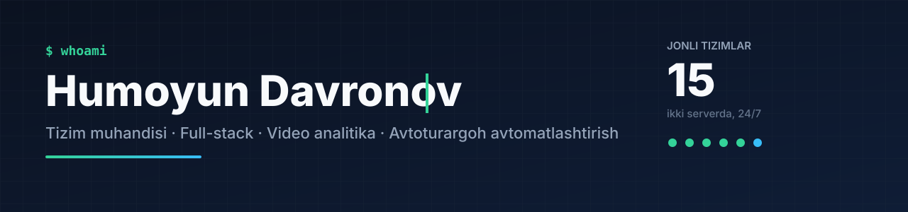

Jizzax, O'zbekiston. Real obyektlarda ishlaydigan tizimlar quraman: kamera va shlagbaumdan tortib server, panel va mobil ilovagacha. Davlat tashkilotlari va biznes uchun **15 ta tizimim** hozir serverlarda jonli ishlayapti.

## 🚗 Avtoturargoh va kirish nazorati

| Loyiha | Nima qiladi | Texnologiya |
|---|---|---|
| [**jarima-maydonchasi**](https://github.com/HumoyunDavronov2001/jarima-maydonchasi) | ANPR kamera, soatlik tarif, EPOS chek, uch shart bajarilgandagina shlagbaum | Go · SQLite · WebView2 · Android |
| [**parkovka-tizimi**](https://github.com/HumoyunDavronov2001/parkovka-tizimi) | Har obyektga o'rnatiladigan parkovka: Hikvision ANPR, turish vaqti hisobi, chek navbati | Rust · tokio · egui |
| [**zomin-kirish-postlari**](https://github.com/HumoyunDavronov2001/zomin-kirish-postlari) | Milliy tabiat bog'i postlari: tashrifchilar, BHM bo'yicha haq, fiskal chek | FastAPI · SQLite |
| [**davomat**](https://github.com/HumoyunDavronov2001/davomat) | Hikvision yuz tanish terminali bilan yo'qlama, oylik tabel | Python · ISAPI |

## 🏛️ Davlat raqamli tizimlari

| Loyiha | Nima qiladi | Jonli |
|---|---|---|
| [**geonazorat-srm**](https://github.com/HumoyunDavronov2001/geonazorat-srm) | Karyerlar nazorati: ANPR, tarozi, yuk xati va e-TTN zanjiri, sputnik ish o'rni | [geonazorat.uz](https://geonazorat.uz) |
| [**bozor-kuzatuv**](https://github.com/HumoyunDavronov2001/bozor-kuzatuv) | Bozor, turargoh, karyer va hosil qabulini real vaqtda kuzatish | [kuzatuv.geonazorat.uz](https://kuzatuv.geonazorat.uz) |
| [**gulnoza-ai**](https://github.com/HumoyunDavronov2001/gulnoza-ai) | Hokimlik uchun ovozli sun'iy intellekt yordamchisi va vaziyat markazi | [gulnoza.geonazorat.uz](https://gulnoza.geonazorat.uz) |
| [**toyxona-nazorat**](https://github.com/HumoyunDavronov2001/toyxona-nazorat) | To'yxonalar: bron, to'lov, QR chek, kamera orqali mehmon sonini sanash | [marosim.geonazorat.uz](https://marosim.geonazorat.uz) |
| [**jizzax-hisobot**](https://github.com/HumoyunDavronov2001/jizzax-hisobot) | 13 tumandan kunlik hisobot, 16 avtomatik nazorat qoidasi, Excel shakli | [soliq.geonazorat.uz](https://soliq.geonazorat.uz) |
| [**mahalla-17**](https://github.com/HumoyunDavronov2001/mahalla-17) | Mahalladagi 17 lavozim uchun yagona platforma: murojaat, tashrif, dalilli hisob | [17lik.geonazorat.uz](https://17lik.geonazorat.uz) |
| [**rasta-bozor**](https://github.com/HumoyunDavronov2001/rasta-bozor) | Bozorlarni raqamlashtirish: SVG plan, ijara, to'lov, mobil kassa | [elektronbozor.uz](https://elektronbozor.uz) |
| [**murojaat-tizimi**](https://github.com/HumoyunDavronov2001/murojaat-tizimi) | Fuqarolar murojaatlari va anonim xabarlar: muddat nazorati, bo'linmalar, statistika | — |
| [**chorva-nazorat**](https://github.com/HumoyunDavronov2001/chorva-nazorat) | Mol bozorlari markazi: sanoq, kassa, o'zgarmas yozuvlar zanjiri, telefon kassa | [mol-bozor.unistart-hub.uz](https://mol-bozor.unistart-hub.uz) |
| [**tarmoq-markazi**](https://github.com/HumoyunDavronov2001/tarmoq-markazi) | Ko'p obyektli tarmoq: MikroTik + WireGuard, kameralar bitta panelda | [markaz.geonazorat.uz](https://markaz.geonazorat.uz) |

## 🤖 Sun'iy intellekt va video analitika

| Loyiha | Nima qiladi |
|---|---|
| [**sanoat-xavfsizlik-ai**](https://github.com/HumoyunDavronov2001/sanoat-xavfsizlik-ai) | Sanoat korxonasi kameralarida AI xavfsizlik nazorati: 75 qoida, zonalar, olov va xavfli harakat, operator tasdig'i |
| [**ofis-miya**](https://github.com/HumoyunDavronov2001/ofis-miya) | Chat orqali CRM: pulni dastur hisoblaydi, sun'iy intellekt faqat taklif qiladi |
| [**vatan-tuygusi**](https://github.com/HumoyunDavronov2001/vatan-tuygusi) | Video havolalardan kadr, ovoz va matn bo'yicha tahlil va portret |

## 🛰️ Geodeziya va global platformalar

| Loyiha | Nima qiladi | Jonli |
|---|---|---|
| [**trace4d**](https://github.com/HumoyunDavronov2001/trace4d) | Yer osti tarmoqlari reestri: iPhone LiDAR + RTK, quvurni aniqlash, 3D, ijro hujjati | [trace4d.geonazorat.uz](https://trace4d.geonazorat.uz) |
| [**tong**](https://github.com/HumoyunDavronov2001/tong) | Har kim o'z tilida: chat, qo'ng'iroq va efirda avtomatik tarjima | [tong.ipak-yoli.uz](https://tong.ipak-yoli.uz) |

## 📊 Ma'lumot va avtomatlashtirish

| Loyiha | Nima qiladi | Jonli |
|---|---|---|
| [**spira-klub**](https://github.com/HumoyunDavronov2001/spira-klub) | Kompyuter klublari: kiosk, Win32 qulf agenti, smena, bar, bron ilovasi | — |
| [**tender-radar**](https://github.com/HumoyunDavronov2001/tender-radar) | 12 ta xarid manbasidan faol lotlar radari va ichki CRM | [tender.geonazorat.uz](https://tender.geonazorat.uz) |

---

📬 Telegram: [@Humoyun_Davronov](https://t.me/Humoyun_Davronov)

